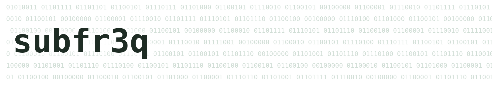

<picture>
  <source media="(prefers-color-scheme: dark)" srcset="assets/header-dark.png">
  <source media="(prefers-color-scheme: light)" srcset="assets/header-light.png">
  
</picture>

## Somewhere around the boundary between intended behavior and implementation details.

### Stack

**C** &nbsp; / &nbsp; **Python** &nbsp; / &nbsp; **Bash** &nbsp; &nbsp; — &nbsp; **Linux**

---

### Offensive Security

**Infrastructure** &nbsp; / &nbsp; Active Directory, Windows & Linux, Privilege Escalation

**Web Applications** &nbsp; / &nbsp; Web exploitation, authentication & access control
